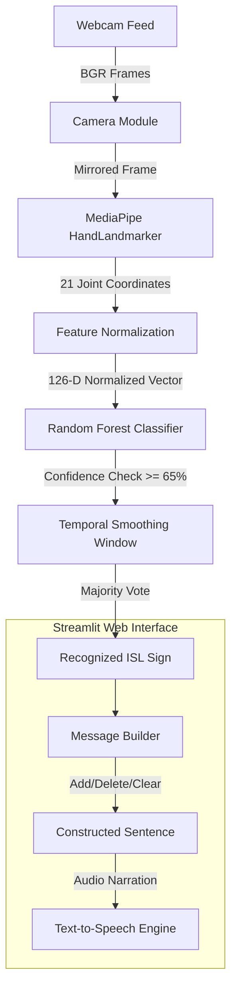

# 🤟 SignBridge – Sign Beyond Words
### *Breaking Communication Barriers with Indian Sign Language*


---

## 📌 1. Project Overview

**SignBridge** is a real-time assistive communication aid developed for hackathons. It bridges the communication gap between Indian Sign Language (ISL) signers and individuals who do not understand sign language. 

Using a standard laptop webcam, SignBridge tracks 21 hand landmarks across one or both hands, classifies the signs using normalized geometric features and machine learning, builds readable sentences from recognized sign glosses, and narrates the message aloud using text-to-speech.

> **Tagline:** *Sign Beyond Words.*

---

## 💡 2. Problem Statement & Proposed Solution

### The Problem
Over 18 million Deaf and hard-of-hearing individuals reside in India, many communicating predominantly via Indian Sign Language (ISL). Because the broader public rarely understands ISL, everyday interactions in hospitals, administrative offices, transportation hubs, and retail stores present immense communication hurdles.

### The Solution: SignBridge
SignBridge serves as an intuitive, low-latency, software-only prototype requiring zero specialized wearable hardware:
1. **Live Camera Input**: Captures standard webcam video with automatic mirroring.
2. **Landmark Extraction**: Tracks 21 3D hand landmarks per hand using Google MediaPipe.
3. **Translation & Scale Invariance**: Normalizes landmarks with respect to the wrist and hand span, ensuring consistent recognition regardless of user distance from the camera or hand size.
4. **Machine Learning Recognition**: Classifies normalized landmark vectors via a lightweight Random Forest model, enriched with confidence thresholding and temporal voting to eliminate flicker.
5. **Interactive Sentence Builder**: Aggregates recognized signs into a coherent message with duplicate suppression and cooldown controls.
6. **Audible Speech Output**: Converts assembled text into natural speech via local Windows SAPI5 and cross-platform browser Web Speech API.

---

## ⚙️ 3. Technology Stack

- **Application Logic**: Python 3.12
- **Computer Vision & Video**: OpenCV (`cv2`)
- **Hand Pose Estimation**: Google MediaPipe Tasks API (`HandLandmarker`)
- **Numerical Processing**: NumPy
- **Machine Learning**: Scikit-learn (`RandomForestClassifier`)
- **Web Interface**: Streamlit
- **Text-to-Speech (TTS)**: `pyttsx3` (Offline desktop SAPI5) & Web Speech API (`SpeechSynthesis`)

---

## 📐 4. System Architecture



---

## 📂 5. Project Directory Structure

```text
signbridge/
│
├── app.py                      # Main Streamlit web application
├── collect_samples.py          # Interactive desktop tool to record labelled landmark samples
├── test_camera.py              # Diagnostic utility to verify camera and MediaPipe tracking
├── requirements.txt            # Python package dependencies
├── README.md                   # Project documentation and demo guide
├── .gitignore                  # Git exclusion rules
│
├── modules/                    # Core modular processing pipeline
│   ├── __init__.py
│   ├── camera.py               # Webcam capture, mirroring, and error handling
│   ├── hand_tracking.py        # MediaPipe 21-point hand tracking & visual styling
│   ├── preprocessing.py        # Coordinate normalization & 126-D feature extraction
│   ├── recognition.py          # Real-time classifier inference & temporal smoothing
│   ├── sentence_builder.py     # Sentence buffer, cooldown debounce, & message editing
│   ├── speech.py               # Dual-engine TTS (pyttsx3 desktop + browser audio)
│   └── training.py             # Random Forest training routine with metrics
│
├── dataset/                    # ISL landmark data storage
│   ├── README.md
│   ├── isl_landmarks.csv       # Labelled normalized landmark dataset (400+ samples)
│   └── seed_dataset.py         # Baseline data generator with anatomical ISL poses
│
├── models/                     # Machine learning artifacts
│   ├── README.md
│   └── signbridge_classifier.pkl  # Trained Random Forest classifier artifact
│
├── docs/                       # Reference documentation
│   └── ISL_VOCABULARY_REFERENCE.md # Complete ISL vocabulary & signing pose guide
│
├── tests/                      # Automated test suite
│   └── test_pipeline.py        # Pipeline regression and verification test suite
│
└── utils/                      # Shared configuration & constants
    ├── __init__.py
    └── config.py               # Sign vocabulary, thresholds, and path definitions
```

---

## 🤟 6. Supported ISL Vocabulary (10 Signs)

SignBridge is pre-configured with 10 high-utility daily communication signs:

| # | Sign Name | ID | Hands | Meaning & Intent | Visual Signing Technique |
|---|---|---|---|---|---|
| 1 | **Hello** | `HELLO` | 1 | Greeting | Open hand raised near temple/head, angled outward in salute/wave |
| 2 | **Namaste** | `NAMASTE` | 2 | Respectful Greeting | Both palms pressed flat together at center chest (*Anjali Mudra*) |
| 3 | **Thank You** | `THANK_YOU` | 1 | Expressing Gratitude | Flat hand fingertips at chin moving forward toward listener |
| 4 | **Yes** | `YES` | 1 | Agreement / Affirmation | Closed fist held forward, nodding downward from the wrist |
| 5 | **No** | `NO` | 1 | Negation / Disagreement | Index finger extended upright waving side-to-side; other fingers curled |
| 6 | **Please** | `PLEASE` | 1 | Polite Request | Open flat palm gently placed over the chest |
| 7 | **Help** | `HELP` | 2 | Emergency / Assistance | Dominant fist with thumb upright resting on flat open palm of other hand |
| 8 | **Good** | `GOOD` | 1 | Quality / Approval | Upright thumbs-up held firmly at chest level |
| 9 | **Water** | `WATER` | 1 | Thirst / Drink | 'W' handshape (index, middle, ring upright) tapped gently at lips |
| 10 | **Goodbye** | `BYE` | 1 | Parting Farewell | Open palm facing forward, waving side-to-side |

*See [`docs/ISL_VOCABULARY_REFERENCE.md`](docs/ISL_VOCABULARY_REFERENCE.md) for detailed linguistic notes.*

---

## 🚀 7. Installation & Setup Guide

### Prerequisites
- **Operating System**: Windows 10/11, macOS, or Linux.
- **Python**: Python 3.12 (check with `py --version`).
- **Hardware**: Built-in laptop webcam or external USB webcam.

### Step 1: Open Terminal & Navigate to Project
```powershell
cd "c:\Users\Admin\OneDrive\Desktop\Documents\emi passport\signbridge"
```

### Step 2: Create & Activate Virtual Environment
```powershell
# Create virtual environment
py -3.12 -m venv .venv

# Activate on Windows (PowerShell)
.\.venv\Scripts\Activate.ps1
```

### Step 3: Install Dependencies
```powershell
pip install -r requirements.txt
```

### Step 4: Run Hardware & Model Diagnostics
```powershell
# Verifies camera and MediaPipe landmark tracking
py test_camera.py

# Verifies complete processing pipeline
py tests/test_pipeline.py
```

---

## 💻 8. How to Run the Application

### Launch the Streamlit Web App
```powershell
streamlit run app.py
```
The application will automatically open in your default web browser at `http://localhost:8501`.

---

## 🎬 9. Hackathon Demonstration Workflow

Follow these steps during your live presentation:

1. **Open the Web Application**:
   - Run `streamlit run app.py`.
   - Show the modern, accessible header with the tagline **"Sign Beyond Words"**.
2. **Start the Camera**:
   - Click **▶ Start Camera** in the left panel.
   - Point out the camera connection status badge turning green (`Camera Active`).
3. **Demonstrate Hand Tracking**:
   - Raise your hand in front of the webcam.
   - Show the 21 MediaPipe skeletal landmark joints (cyan nodes) and bones (blue connections) rendered on screen.
4. **Demonstrate Sign Recognition**:
   - Form an ISL sign (e.g., `HELLO` or `GOOD` thumbs-up).
   - Point out the **Confidence Bar** rising above the $65\%$ threshold.
   - Note the **Recognized Sign** card displaying the sign name and its English meaning.
5. **Build a Sentence**:
   - Show how the message builder automatically or manually adds recognized words:  
     `"Hello"` $\rightarrow$ `"Please"` $\rightarrow$ `"Help"`.
   - Demonstrate the **⌫ Delete Last Word** button to correct an input.
6. **Trigger Text-to-Speech**:
   - Click **🔊 Speak Message**.
   - Listen to the laptop narrate the sentence out loud through the speakers.
   - Click **🔁 Repeat Speech** to replay.
7. **Demonstrate Two-Handed Signs**:
   - Form the `NAMASTE` or `HELP` sign using both hands.
   - Point out that the 126-dimensional normalization architecture effortlessly processes both single-hand and two-hand configurations!

---

## 🛠️ 10. Sample Collection & Model Retraining

SignBridge empowers users to record new labelled landmark samples directly:

### Interactive OpenCV Recorder
```powershell
py collect_samples.py
```
- Press keys `[0]` through `[9]` to select the target sign.
- Hold the pose steadily in front of the camera.
- Press `[SPACE]` to capture a 30-frame burst of normalized landmarks.
- Press `[C]` to toggle continuous recording.
- Press `[Q]` to save and exit.

### Retrain the Classifier
```powershell
py -m modules.training
```
Or click **🚀 Train Model Now** directly in the **"Dataset & Model Status"** tab of the Streamlit web application.

---

## ⚠️ 11. Ethical Considerations & Limitations

1. **Vocabulary Scope**: SignBridge is an educational hackathon prototype built to demonstrate feasibility with a curated set of 8–10 everyday signs. It is **not** a full ISL translation engine.
2. **Grammar Notice**: Directly stringing together sign glosses (e.g., `"Hello Please Help"`) serves as a functional communication aid, but does not represent the full visual, spatial, and grammatical complexity of natural ISL conversation.
3. **Data Integrity**: SignBridge strictly avoids synthetic fake datasets or arbitrary gestures masquerading as genuine ISL. All data collection conforms to verified ISL visual references.

---

## 🔮 12. Future Improvements

- [ ] **Dynamic Sign Trajectory Tracking**: Integrate LSTM / 1D-CNN temporal sequence models to capture multi-second dynamic movement signs.
- [ ] **Facial Expression & Head Pose Integration**: Add MediaPipe Face Mesh to capture non-manual markers (raised eyebrows, head tilts) which convey grammatical tense and mood in ISL.
- [ ] **LLM Contextual Grammar Expansion**: Connect lightweight local LLMs (e.g. Gemini Nano) to translate raw sign glosses into fluent, grammatically natural spoken sentences.
- [ ] **Mobile & Progressive Web App (PWA)**: Package the inference runtime with WebAssembly/ONNX Runtime Web for offline smartphone camera usage.

---

## 👥 Contributors & Acknowledgements
- **Author & Developer**: Emi Mariyam (`emimariamshiju@gmail.com`)
- **Collaborator**: `NidhiyaS25`
- **Supported By**: Indian Sign Language Research and Training Centre (ISLRTC) published sign guidelines.

*Sign Beyond Words.*
